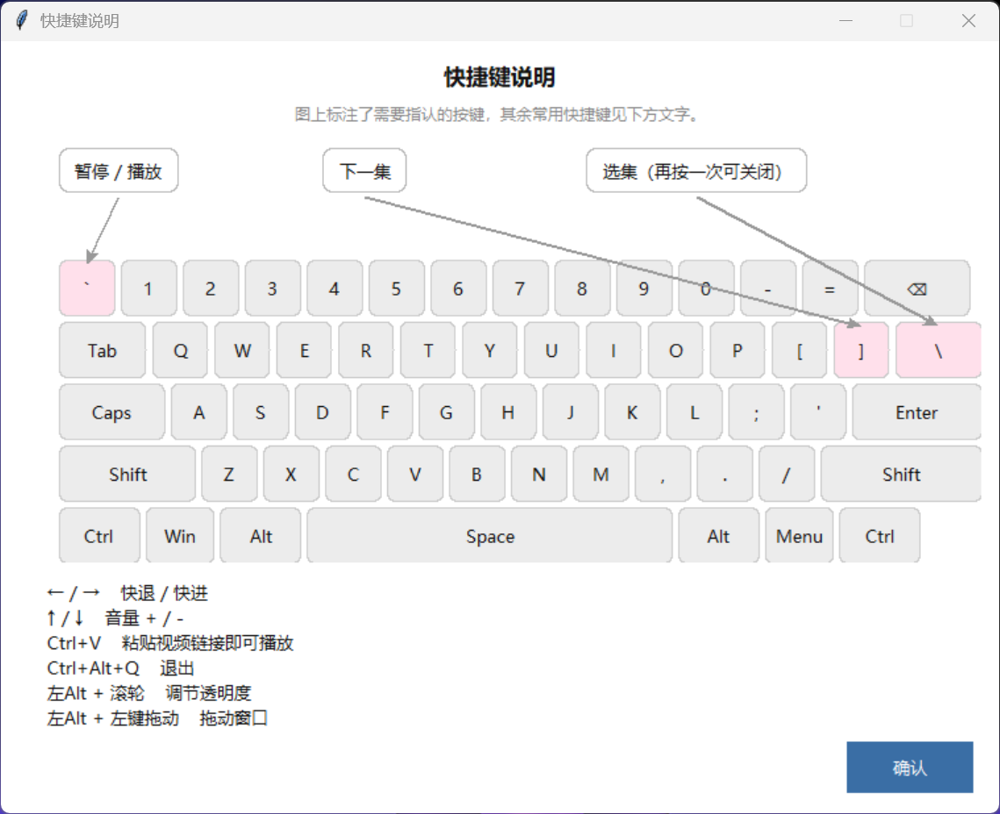
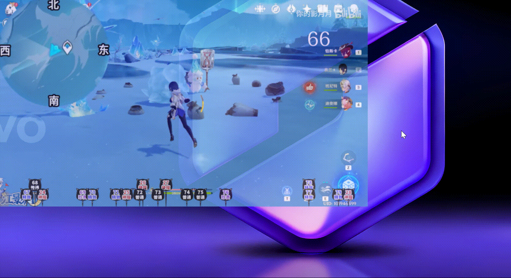

# 🎮 GongLuePlayer · 攻略跟跑视频播放器

> 玩攻略类游戏时，悬浮在屏幕角落的极简「跟跑」播放器——边看攻略边操作，互不干扰。

<p align="center">
  <a href="https://github.com/wangcuitao/GongLuePlayer/stargazers"></a>
  <a href="https://github.com/wangcuitao/GongLuePlayer/network/members"></a>
  <a href="https://github.com/wangcuitao/GongLuePlayer/blob/main/LICENSE"></a>
  <a href="https://www.python.org/downloads/release/python-3110/"></a>
  <a href="https://www.microsoft.com/windows"></a>
</p>

---

## 📖 项目简介

在玩《原神》《艾尔登法环》这类需要对照攻略的游戏时，来回切换窗口看攻略视频既打断节奏又低效。**GongLuePlayer** 把攻略视频变成一个「悬浮在游戏上、鼠标可穿透、全局快捷键可控」的极简窗口，让你一边打游戏一边跟跑攻略。

核心亮点：

- 🪶 **极致轻量**：打包后 EXE 仅约 67MB，运行内存占用低，全程不使用任何浏览器内核。
- 🖱️ **鼠标穿透**：默认鼠标穿透窗口直接操作下层游戏，按住 `Alt` 才可交互（拖动、点击）。
- 📋 **一键播放**：复制 B 站链接后按 `Ctrl + V` 即可解析播放，自动识别合集并支持切换。
- ⌨️ **全局快捷键**：即使在游戏窗口内，也能用 `` ` ``、方向键等控制播放。

---

## 🖼️ 效果展示





---

## ✨ 核心特性

- **鼠标穿透 + Alt 交互**
  默认状态鼠标事件直接穿透窗口落到下层游戏；按住 `左Alt` 临时解除穿透，此时可拖动窗口、点击按钮、调节透明度，松开即恢复穿透。

- **粘贴即播，B 站合集自动识别**
  复制 `bilibili.com/video/BV...` 或 `b23.tv` 短链，按 `Ctrl + V` 自动解析并播放；识别合集 / 多 P，可用 `、` 键打开选集菜单、`]` 键切换下一集，还支持从指定分 P（`?p=N`）开始播放。

- **全局快捷键**
  基于 `keyboard` 实现，窗口失焦（正在打游戏）时依然生效。

- **纯净画面 + 悬浮控制**
  无边框、始终置顶、半透明；不按 Alt 时窗口纯净显示视频，按 Alt 后鼠标移到上半区显示顶部控制（标题滚动、暂停/下一集、设置/关闭），移到下半区显示进度条与选集。

- **极致轻量**
  Tkinter（Python 自带）作 UI、MPV 作内核、yt-dlp 作解析，全程零浏览器、零 Qt，体积与内存都控制在极低水平。

- **可深度定制**
  内置设置面板：自定义所有全局快捷键（按键录制）、是否自动连播、默认透明度、快进快退步长、音量步长、窗口背景色 / 进度条滑块色（支持调色盘与全局吸色笔）。

- **会员高清**
  导出 B 站 Cookie 后即可请求 1080P / 4K 会员画质（详见 [安装与使用](#-安装与使用)）。

---

## ⌨️ 快捷键列表

| 快捷键 | 功能 |
| :--- | :--- |
| `` ` ``（数字 1 左边） | 暂停 / 播放 |
| `←` / `→` | 快退 / 快进 5 秒 |
| `↑` / `↓` | 音量 + / − |
| `]` | 下一集 |
| `、`（P 键右边第三个） | 打开 / 关闭选集菜单 |
| `Ctrl + V` | 粘贴 B 站链接播放 |
| `Ctrl + Alt + Q` | 退出程序 |
| `Alt`（按住） | 解除鼠标穿透 + 显示悬浮控制 |
| `Alt + 滚轮` | 调节透明度 |
| `Alt + 鼠标左键` | 拖动窗口 |

> 所有快捷键均可在「设置」面板中自定义。

---

## 🚀 安装与使用

### 普通用户（推荐）

1. 前往 [Releases](https://github.com/wangcuitao/GongLuePlayer/releases) 下载最新的 `GongLuePlayer.exe`（便携版，无需安装 Python）。
2. 双击运行。首次启动会弹出 UAC（用户账户控制）提示，点击「是」——这是正常的，程序需要管理员权限才能实现全局快捷键与鼠标穿透。
3. 复制 B 站链接，按 `Ctrl + V` 即可播放。

> 💡 若 Windows SmartScreen 提示「已保护你的电脑」，点击「更多信息」→「仍要运行」。

### 开发者

```bash
# 1. 克隆仓库
git clone https://github.com/wangcuitao/GongLuePlayer.git
cd GongLuePlayer

# 2. 安装依赖（建议 Python 3.10 / 3.11）
pip install -r requirements.txt

# 3. 下载 libmpv-2.dll
#    来源：https://sourceforge.net/projects/mpv-player-windows/files/libmpv/
#    将解压得到的 libmpv-2.dll 放到项目根目录

# 4. 运行（需管理员权限）
python main.py
```

### 导出 B 站 Cookie（会员高清）

程序通过读取根目录的 `cookies.txt` 以会员身份请求 1080P / 4K 画质：

1. 用 Chrome / Edge 登录 bilibili.com 并保持登录。
2. 安装浏览器扩展 **Get cookies.txt LOCALLY**。
3. 打开任意 B 站页面，点击扩展图标 →「Export」导出。
4. 将导出的文件重命名为 `cookies.txt`，放到程序所在目录（EXE 同级目录）。

> 也可以在程序内「设置 → B站会员登录」查看完整图文步骤。

---

## ❓ FAQ

**Q：为什么需要管理员权限？**

全局快捷键（`keyboard` 库）需要管理员权限才能向系统注册全局键盘钩子；`pywin32` 修改窗口穿透属性（`WS_EX_TRANSPARENT`）也依赖较高权限。程序仅使用这些权限完成上述功能，不涉及任何隐私数据。

**Q：杀毒软件 / Windows Defender 报毒怎么办？**

PyInstaller 打包的单文件程序常被启发式误报。本仓库完全开源，可自行审阅源码后本地打包，或在杀软中为程序添加信任。若仍有顾虑，请使用「开发者」方式从源码运行。

**Q：在游戏内按快捷键无效？**

请确认程序是以「管理员身份」运行的（右键 → 以管理员身份运行）。部分游戏使用独占全屏模式会屏蔽全局快捷键，可尝试将游戏切换到无边框窗口模式。

**Q：如何打包为 EXE？**

```bash
pip install pyinstaller
pyinstaller --noconfirm --clean --onefile --windowed --name GongLuePlayer \
  --add-data "libmpv-2.dll;." \
  --exclude-module numpy --exclude-module pandas --exclude-module matplotlib \
  --exclude-module scipy --exclude-module PIL --exclude-module cv2 \
  --exclude-module PyQt5 --exclude-module PyQt6 \
  --exclude-module PySide2 --exclude-module PySide6 \
  main.py
```

打包产物位于 `dist/GongLuePlayer.exe`。

**Q：支持弹幕吗？**

暂不支持。弹幕渲染需要额外解析与绘制，当前版本聚焦于「极致轻量」；后续如有需要会在不引入浏览器内核的前提下考虑扩展。

---

## 📄 开源协议

本项目基于 [MIT License](LICENSE) 开源，欢迎 Star、Fork、提交 Issue 与 PR。

## 🙏 致谢

本项目站在巨人肩膀上，感谢以下开源项目：

- [mpv](https://github.com/mpv-player/mpv) —— 强大的播放内核
- [python-mpv](https://github.com/jaseg/python-mpv) —— Python 绑定
- [yt-dlp](https://github.com/yt-dlp/yt-dlp) —— 流媒体解析
- [pywin32](https://github.com/mhammond/pywin32) —— Windows API 封装
- [keyboard](https://github.com/boppreh/keyboard) —— 全局键盘钩子

---

## ⚠️ 免责声明

> **本程序仅供个人学习与游戏辅助使用，严禁用于任何商业用途。程序不提供、不存储任何视频内容，所有内容均来自 Bilibili 官方 API。请尊重视频原作者的版权，合理使用。**
